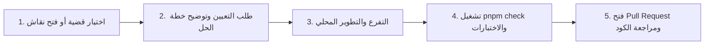

<div dir="rtl" align="right">

# دليل المساهمة في AS_FIT (Contributing Guide)

**[📖 Read in English (CONTRIBUTING.md)](./CONTRIBUTING.md)** · **[🎯 بنك القضايا الجاهزة للمساهمين](./docs/GOOD_FIRST_ISSUES.md)**

شكراً لاهتمامك بالمساهمة في **AS_FIT**! صُمّم هذا المستودع ليكون مرجعاً مفتوح المصدر يجمع بين **الدقة العلمية في القياس الأيضي** و**الهندسة البرمجية النظيفة** و**تجربة الاستخدام العربية الهادئة**.

يوضّح هذا الدليل **أشكال وأساليب المساهمة المتاحة**، **رحلة المساهم لحل القضايا خطوة بخطوة**، و**الضوابط المعمارية والبصرية الإلزامية** المفروضة آلياً في `CI`.

---

## 1. أشكال وأساليب المساهمة (6 مسارات متخصصة)

لا تقتصر المساهمة في **AS_FIT** على كتابة كود الخادم؛ يمكنك المشاركة عبر **6 مسارات متكاملة** حسب تخصصك:

### أ) مسار المحرك العلمي وقواعد التحليل الذكي (`area:domain` · `area:insights`)
- **لمن؟** الباحثون في التغذية وعلوم الرياضة، ومطورو الخوارزميات المهتمون بالنمذجة الرياضية.
- **أشكال المساهمة:**
  - اقتراح أو بناء قواعد تنبيه جديدة في `src/domain/insights/rules/` تطبق الواجهة `InsightRule` وتُنتج `payload` رقمياً يفسّر سبب التنبيه.
  - مراجعة المعادلات الحالية أو اقتراح تحسينات رياضية مدعومة **بمراجع علمية محكّمة (`Peer-Reviewed Citations`)** عبر قالب المراجعة العلمية.
- **الشرط الذهبي:** دوال نقية 100% بلا أي عمليات إدخال/إخراج (`IO`)، مرفقة باختبارات وحدات (`Vitest`)، وخصائص رياضية (`fast-check`)، وتغطية `>= 95%` على `src/domain/**`. راجع [SCIENTIFIC_MODEL.md](./docs/SCIENTIFIC_MODEL.md).

### ب) مسار الواجهة وتجربة المستخدم والوصولية (`area:ui`)
- **لمن؟** مطورو الواجهات الأمامية (`React` / `Tailwind CSS v4`) ومصممو تجربة الاستخدام العربية (`RTL`).
- **أشكال المساهمة:** تحسين التجاوب على شاشات الجوال (`375px`) وسطح المكتب (`1440px`)، الوصولية (`ARIA` ولوحة المفاتيح)، والرسوم البيانية في `Recharts`.
- **الشرط الذهبي:** الالتزام التام بهوية `Light & Green` في [DESIGN_SYSTEM.md](./docs/DESIGN_SYSTEM.md) — **يُمنع منعاً باتاً استخدام الأصفر أو البرتقالي أو الأحمر أو أي لون خام (`#hex`)**، ويُمنع استخدام الأصناف الاتجاهية الفيزيائية (`ml-`, `mr-`, `text-left`...).

### ج) مسار الخادم وقاعدة البيانات والميزات الوظيفية (`area:server` · `area:db`)
- **لمن؟** مطورو `Next.js App Router` و`PostgreSQL` و`Drizzle ORM`.
- **أشكال المساهمة:** بناء ميزات تصدير واستيراد البيانات (`CSV` / `JSON`)، قوالب الوجبات المتكررة، وترحيلات `Drizzle`.
- **الشرط الذهبي:** التحقق الصارم بمخططات `Zod 4`، الحفاظ على مبدأ **اللقطة الثابتة (`Snapshot over Recompute`)** حتى لا تتغير البيانات التاريخية، ودعم وضع المحاكاة `MOCK_MODE` في استعلامات القراءة. راجع [ARCHITECTURE.md](./docs/ARCHITECTURE.md).

### د) مسار الاختبارات وضمان الجودة (`area:testing`)
- **أشكال المساهمة:** إضافة اختبارات حالات حدّية وخصائص (`fast-check`) وتوسيع مسارات `Playwright E2E` في `tests/e2e/`.

### هـ) مسار البيئة المحلية والأدوات العابرة للأنظمة (`area:devops`)
- **أشكال المساهمة:** تطوير سكربتات نسخ احتياطي واستعادة تعمل على `Linux` و`macOS` و`Windows`، وتحسين بيئة الاختبارات المعزولة في Docker.

### و) مسار التوثيق وحزم القواميس الاختيارية (`area:docs`)
- **أشكال المساهمة:** تحسين الشروحات ثنائية اللغة أو إعداد ملفات قواميس أغذية ومشروبات قياسية قابلة للاستيراد الاختياري.

---

## 2. رحلة المساهم وحل القضايا (Issue-to-PR Workflow)



1. **اختيار القضية:** ابدأ من **[بنك القضايا الجاهزة للمساهمين (GOOD_FIRST_ISSUES.md)](./docs/GOOD_FIRST_ISSUES.md)** أو القضايا الموسومة بـ `good first issue` / `status:help-wanted`.
2. **طلب التعيين وسياسة الـ 14 يوماً:** اترك تعليقاً يوضح خطة الحل في سطرين ليتم تعيين القضية لك. القضايا غير النشطة لمدة **14 يوماً** قد يُعاد إتاحتها لمساهمين آخرين.
3. **التفرع والالتزامات البرمجية:** استخدم تسمية فروع معبّرة (`feat/...`، `fix/...`، `rule/...`، `docs/...`) ورسائل `Conventional Commits`.
4. **التشغيل السريع:**
   - للواجهة والنطاق العلمي بدون قاعدة بيانات: `USE_MOCK_DATA=true pnpm dev`
   - للتطوير الكامل مع PostgreSQL: `pnpm db:up && pnpm db:migrate && pnpm db:seed && pnpm dev`

---

## 3. التحقق الإلزامي قبل إرسال طلب السحب (`Pre-PR Check`)

شغّل الأوامر التالية وتأكد من نجاحها بالكامل قبل فتح الـ `Pull Request`:

```bash
pnpm check
pnpm test:coverage
```

ينفّذ `pnpm check` بالتتابع: `lint` + `typecheck` + `check:conventions` (فاحص الألوان وRTL وحدود الطبقات) + `vitest`. وإذا شمل تعديلك مسارات تفاعلية أو إعدادات بناء، شغّل حاوية الاختبار المعزولة وتحقّق من `Playwright E2E`:

```bash
pnpm test:db:up
pnpm test:e2e
pnpm test:db:down
```

</div>
