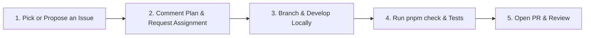

# Contributing to AS_FIT

**[📖 اقرأ دليل المساهمة باللغة العربية (CONTRIBUTING.ar.md)](./CONTRIBUTING.ar.md)** · **[🎯 Starter Issue Backlog](./docs/GOOD_FIRST_ISSUES.md)**

Thank you for your interest in contributing to **AS_FIT**! This project combines **rigorous metabolic science**, **clean layered engineering**, and **a calm Arabic-first (`RTL`) telemetry interface**.

This guide explains **all 6 ways you can contribute**, our **Issue-to-PR resolution workflow**, and the **non-negotiable architectural and visual guardrails** enforced by CI.

---

## 1. Ways to Contribute (6 Contribution Tracks)

You don't need to be a full-stack developer to make a meaningful impact. Contributions are organized into **6 clear tracks**:

1. **Domain Science & Insights (`area:domain` · `area:insights`)**
   - Propose or implement new pure TypeScript insight rules under `src/domain/insights/rules/` implementing `InsightRule` with explainable numerical payloads.
   - Audit or refine metabolic equations backed by **peer-reviewed academic citations**, unit tests, Golden Values, and `fast-check` property invariants. See [docs/SCIENTIFIC_MODEL.md](./docs/SCIENTIFIC_MODEL.md).
2. **UI/UX, RTL Polish & Accessibility (`area:ui`)**
   - Improve mobile (`375px`) and desktop (`1440px`) ergonomics, keyboard navigation, ARIA semantics, and Recharts visualizations while strictly following [docs/DESIGN_SYSTEM.md](./docs/DESIGN_SYSTEM.md).
3. **Backend, Data Ownership & Features (`area:server` · `area:db`)**
   - Build local-first data tools (CSV/JSON export & import, meal templates), Drizzle schema migrations, and Zod-validated Server Actions while preserving **Snapshot-over-Recompute** and `MOCK_MODE` parity. See [docs/ARCHITECTURE.md](./docs/ARCHITECTURE.md).
4. **Testing & Quality Assurance (`area:testing`)**
   - Expand edge-case unit/property tests (midnight wrap-around, timezone transitions, sparse weigh-in gaps) and Playwright E2E flows under `tests/e2e/`.
5. **Local DevOps & Cross-Platform Tooling (`area:devops`)**
   - Improve cross-platform backup/restore scripts (`Linux` / `macOS` / `Windows`), isolated E2E Docker Compose setups, and CI pipelines.
6. **Documentation & Optional Starter Catalogs (`area:docs`)**
   - Improve bilingual guides, examples, or optional importable JSON food/beverage starter packs (while keeping default database catalogs empty by design).

---

## 2. Issue-to-PR Workflow & Claiming Issues



1. **Find an Issue**:
   - New to the repo? Check **[docs/GOOD_FIRST_ISSUES.md](./docs/GOOD_FIRST_ISSUES.md)** or browse GitHub Issues labeled `good first issue` or `status:help-wanted`.
   - Difficulty labels: `good first issue` (1–3 files, clear scope), `intermediate` (cross-layer feature), `deep-dive` (architectural/scientific design discussion required first).
   - Proposing a new idea? Open an Issue using our structured templates before writing large PRs so we can align on scope.
2. **Claiming & Stale Policy**:
   - Comment on the issue briefly describing your planned approach to get assigned.
   - To keep issues moving for everyone, assigned issues with **no activity or update for 14 days** may be politely unassigned so another contributor can pick them up.
3. **Branch & Commit Conventions**:
   - Branch from `main`: `feat/<short-name>`, `fix/<short-name>`, `rule/<insight-name>`, `test/<topic>`, or `docs/<topic>`.
   - Use clear Conventional Commits (e.g., `feat(insights): add sleep midpoint drift rule`, `fix(validation): ...`).

---

## 3. Setting Up Your Development Environment

1. **Fork & Clone**:
   ```bash
   git clone https://github.com/<your-username>/as_fit.git
   cd as_fit
   pnpm install
   cp .env.example .env
   ```
2. **Choose Your Mode**:
   - **Fast UI / Domain Mode (No PostgreSQL needed)**: Set `USE_MOCK_DATA=true` in `.env` and run `pnpm dev`.
   - **Full Stack Mode (PostgreSQL 16 via Docker)**: Keep `USE_MOCK_DATA=false` and run:
     ```bash
     pnpm db:up
     pnpm db:migrate
     pnpm db:seed
     pnpm dev
     ```
     *(Tip: If port `5432` is already used on your machine, set `POSTGRES_PORT=5433` and update `DATABASE_URL` in `.env`.)*

---

## 4. Non-Negotiable Architectural & UI Guardrails

CI automatically enforces these boundaries via `pnpm check`:

1. **Pure Domain (`src/domain/**`)**: Zero IO, zero framework/ORM/server imports, no implicit `Date.now()`, and **>= 95% Vitest coverage** on `src/domain/**`.
2. **Strict Layering**: `src/app/**` and `src/components/**` must never import `@/server/db/*` or `drizzle-orm` directly. Reads go through `src/server/queries/**` (supporting `MOCK_MODE`); writes go through Zod-validated `src/server/actions/**`.
3. **Snapshot Integrity**: Computed calories, macros, caffeine, and MET burns are stored at log time—dictionary edits must never retroactively mutate past logs.
4. **Calm `Light & Green` Palette Only**: **Yellow, orange, red, bright colors, and raw `#hex` / `rgb()` / `hsl()` literals in components are strictly banned.** Use semantic `@theme` tokens from `src/styles/globals.css` (`brand`, `warning`, `danger`, `ink`, `line`) and always carry attention meaning in text labels, never color alone.
5. **Logical RTL Classes Only**: Use `ms-*`, `me-*`, `ps-*`, `pe-*`, `start-*`, `end-*`, `text-start`, `text-end`. Physical classes (`ml-*`, `mr-*`, `pl-*`, `pr-*`, `left-*`, `right-*`, `text-left`, `text-right`) fail `pnpm check:conventions`.
6. **Arabic UI Units & `<Num />` / `<bdi>`**: User-facing units stay in Arabic (`سعرة`, `غ`, `ملغ`, `مل`, `كغ`, `سم`, `س`, `د`) with numbers rendered in tabular monospace (`<Num />` / `<bdi>`).
7. **Lean Dependencies**: Do not add new npm packages without prior approval in an issue.

---

## 5. Pre-PR Verification Checklist

Run the unified verification command locally before opening your Pull Request:

```bash
pnpm check
pnpm test:coverage
```

If your change modifies database queries, Server Actions, build config, or interactive user flows, also verify:

```bash
pnpm test:db:up
pnpm test:e2e
pnpm test:db:down
```

Never commit `.env` files, personal health exports, or `backups/`. Thank you for helping build AS_FIT!
